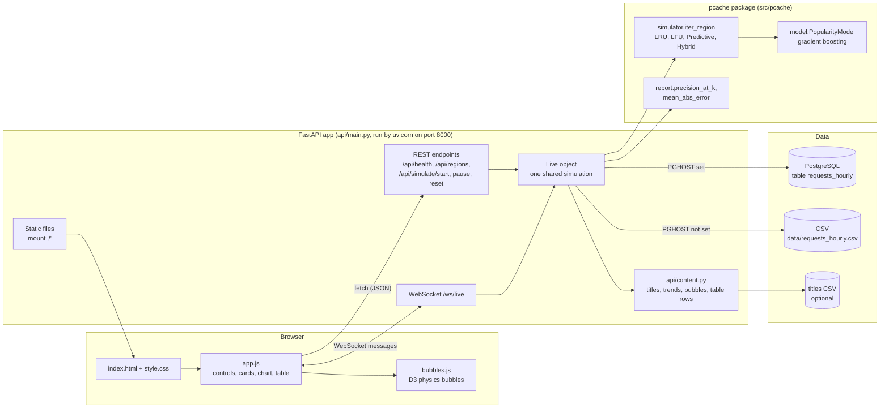
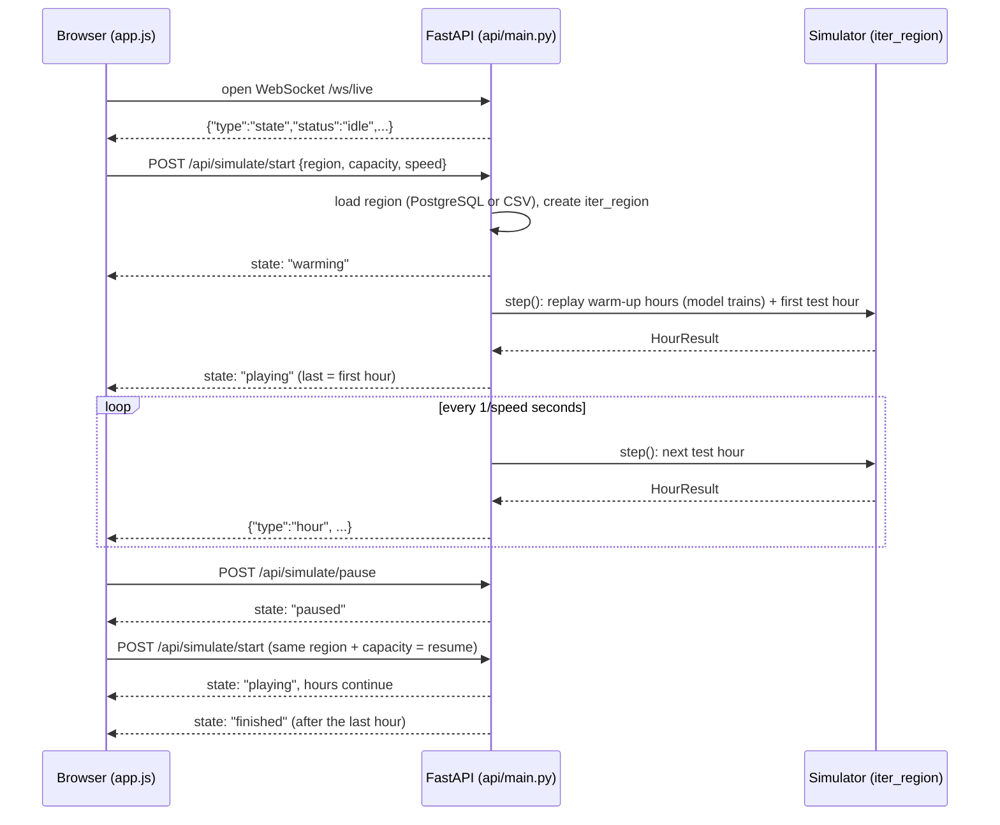

# Dashboard guide

A beginner-friendly tour of the live dashboard: what you see, where every number comes from,
and how the code behind it works. Everything here describes the code as it is
(`api/main.py`, `api/content.py`, `web/index.html`, `web/app.js`, `web/bubbles.js`, `web/style.css`).
Each section starts in plain words, then gives the technical detail.

Contents
1. [Big picture](#1-big-picture)
2. [Every part of the page](#2-every-part-of-the-page)
3. [The backend (api/)](#3-the-backend-api)
4. [The frontend (web/)](#4-the-frontend-web)
5. [Code walkthrough](#5-code-walkthrough)
6. [Glossary](#6-glossary)
7. [Run it, change the look, fix problems](#7-run-it-change-the-look-fix-problems)

---

## 1. Big picture

**In plain words.** The dashboard is a "replay" of real CDN traffic. When you press Start, the
server loads one region's request history, uses the first half of the hours to train the
prediction model (the *warm-up*), and then plays the second half back one hour at a time.
After every simulated hour it sends one message to your browser. The browser redraws the
cards, the chart, the bubbles and the table from that message. There is **one shared
simulation** on the server: every open browser tab sees the same run.

**Step by step, from opening `http://localhost:8000` to moving bubbles:**

1. The browser asks the server for `/`. FastAPI serves `web/index.html`, then `style.css`,
   `bubbles.js`, `app.js`, and D3 from the cdnjs CDN.
2. `app.js` starts and does three things: disables the buttons that make no sense yet,
   calls `GET /api/regions` to fill the Region list, and opens a WebSocket to `/ws/live`.
3. On connect, the server immediately sends a **state** message (status, config, history so far).
   A fresh server says `"status": "idle"`, so the page shows "Ready".
4. You pick a region, capacity and speed and press **Start**. `app.js` sends
   `POST /api/simulate/start` with `{region, capacity, speed}`.
5. The server loads that region (from PostgreSQL or the CSV), creates the simulation
   (`iter_region` in `src/pcache/simulator.py`) and starts a background loop. Status becomes
   **Warming up**.
6. The first step replays all warm-up hours at once (this trains the model inside
   `iter_region`) and the first test hour. Status becomes **Playing**; a state message carries
   that first hour.
7. From then on, every `1 / speed` seconds the loop simulates one more hour and broadcasts an
   **hour** message to every connected browser.
8. Each hour message makes `app.js` redraw everything and call `Bubbles.update(...)`. The
   bubbles themselves move continuously (about 60 times a second) thanks to a D3 physics
   simulation; the hour message only changes *which* bubbles exist and how big they should be.
9. When the last hour is done, status becomes **Finished**.

### Architecture



### WebSocket flow



---

## 2. Every part of the page

### Header: title, data source, controls

**What it shows.** The title, a small line under it saying where the data comes from, and the
controls.

- **Data source line** (`#source`): "PostgreSQL · requests_hourly" when the server uses the
  database, "Local CSV" otherwise, "Data source unavailable" if `/api/regions` failed (the page
  then retries every 5 seconds). Set by `loadRegions()` in `app.js` from the `source` field of
  `GET /api/regions`.
- **Region**: one simulation per region (a CDN edge cluster, e.g. `CDN-edge-eag`). The list comes
  from `/api/regions`.
- **Capacity**: how many objects (videos) the cache can hold. 10 to 5000, default 200. The browser
  checks the range before sending; the server checks it again (`StartRequest`: `ge=10, le=5000`).
- **Speed**: simulated hours per second: 0.5, 1, 2 or 5 (the server accepts 0.25 to 5). It is the
  pause between hours (`asyncio.sleep(1 / speed)`); if one hour takes longer to compute than that,
  the real pace is slower. Changing Speed while playing re-sends Start with the new speed; the
  simulation keeps going (same region and capacity), only the pace changes.
- **Start**: starts a new run, or resumes a paused one. The label changes to "Warming up…" while
  the model trains and to "Resume" when paused. It is disabled while running.
  - Same region and capacity as the current run → resume (nothing is reloaded).
  - Different region or capacity → a new run from scratch.
  - After **Finished**, Start with the same settings does nothing new: press Reset first.
- **Pause**: stops after the hour in progress. Only enabled while running.
- **Reset**: clears everything back to "Ready". It waits for an hour in progress to finish, so no
  stale hour arrives after the reset.

### Progress bar

**What it shows.** A status pill (Ready, Warming up, Playing, Paused, Finished, Error,
Reconnecting) and a line like `CDN-edge-eag · hour 120 · test hour 25 of 97`.

**Where it comes from.**
- `total` = number of test hours = `hours − hours // 2` (the second half). For the Meta data,
  193 hours give 97 test hours.
- The bar fill is `history.length / total`.
- "Reconnecting" means the WebSocket closed (for example the server stopped); the page tries
  again every 1.5 seconds.

### The four metric cards

Each card shows this hour's value and, underneath, the change versus the previous hour
(green = better, pink = worse, grey = "No change vs last hour"). The change line is computed in
`delta()` in `app.js`; for "Average guess error" lower is better, so a drop shows green.

| Card | What it means | Where the number comes from | How to read it |
|---|---|---|---|
| **Model picks that were right** (x / 10) | Of the 10 videos the model expected to be busiest this hour, how many were really in the real top 10. | `precision` in the hour message = `precision_at_k(predicted, actual, 10)` (`src/pcache/report.py`), shown as `round(precision × 10)`. | **This hour only**, not cumulative. 10/10 = the model's top 10 matched the real top 10 exactly (order does not matter). |
| **Average guess error** (views) | How far the predicted request count was from the real one, on average per video. | `mae` = `mean_abs_error(predicted, actual)`: average of \|predicted − actual\| over every video the model scored **plus** every video that was really requested (a video the model skipped counts as predicted 0). | This hour only. Lower is better. Most videos get few requests, so values are usually small. The card says "views" but the unit is requests. |
| **Hybrid's lead over LFU** (pts) | How many percentage points more requests Hybrid served from cache than LFU. | `hybrid_lead` = (running Hybrid hit rate − running LFU hit rate) × 100. | **Running since the test hours began.** Positive = Hybrid ahead. Note it compares with LFU, not LRU, which is the stronger baseline on the Meta data. |
| **Hybrid hit rate** (%) | Share of all requests in the test hours that Hybrid served straight from cache. | `hit_rate.Hybrid` (running hit rate × 100). | Running since the test hours began. |

### Running hit-rate chart

**What it shows.** One line per policy (Hybrid, Predictive, LFU, LRU): the running hit rate after
each test hour. The legend shows the latest value of each line. Hover (or tap) to see a vertical
rule and all four values at the nearest hour.

**Where it comes from.** `history` = one `{hour, hit_rate}` per test hour, kept by the browser
(and sent in full in every state message, so a tab opened mid-run gets the whole history).
`hit_rate` is the *running* rate: hits ÷ requests since the first test hour, per policy.

**How to read it.** Higher is better. Lines usually wobble at the start (few requests counted) and
then flatten. Lines are told apart by colour **and** dash pattern (Hybrid solid and thicker,
Predictive dashed, LFU dotted, LRU long dashes), so they work without colour vision. The y-axis
zooms to the data (min − 2 to max + 2 points, never below 0 or above 100), so small gaps look
large: check the numbers.

The hour message also carries `hourly_hit_rate` (hit rate within that hour only). The page does
not display it.

### "Trending now" bubbles

**What it shows.** This hour's 20 most-requested videos (only those with at least one request).

- **Size**: bubble *area* is proportional to the video's requests this hour (radius ∝ √requests).
  The scale is chosen so all bubbles together cover about a third of the stage; each radius is
  kept between 22 px and 24 % of the stage's shorter side. Sizes glide to their new value when a
  new hour arrives.
- **Colour**: **green** = the model had this video among its own top 20 predictions for this hour
  ("Model predicted it"); **pink** = it did not ("Model missed it"). Field `hit` in the bubble data.
- **Label**: always "Video <id>" (field `label`), shown if the bubble is at least 34 px wide. Under it
  a small **type chip** such as "Type 4" (at least 84 px wide, and only if the video has a type),
  then the request count plus a trend arrow (at least 70 px), then the trend in words (at least 110 px).
- **Trend tag**: compares this hour's requests with the average of the previous 3 hours, adding 2
  to both to keep tiny counts calm: ratio = (now + 2) / (before + 2).
  - ratio ≥ 1.5 → **↑ rising fast** (orange)
  - ratio ≤ 1/1.5 → **↓ fading** (cyan)
  - otherwise → **→ steady**
  - No trend is shown until there are at least two hours of history.
- **Type and size**: `Type N` (content type) and a size such as `1.5 MB` (B, KB, MB, GB). In database
  mode they come from the `titles` table for the selected region (loaded once per run); in CSV mode
  from the titles file's `content_type` and `size_bytes` columns. A video with no row (or no value)
  simply shows no chip, no type and no size; nothing breaks.
- **Tooltip** (hover): "Video <id>", the stored title underneath (if it differs), content type, size,
  actual requests, predicted requests (one decimal), region, predicted/missed and trend. The top-10
  table shows the same trend, type and size chips.

**Physics (how they move).** It is a D3 force simulation that never stops (`alphaDecay(0)`):

- A gentle pull toward the centre, and collision so bubbles don't overlap.
- **Wander**: a slow floating drift (switched off if your system asks for reduced motion).
- **Repel**: bubbles within 80 px of the cursor are pushed away. The bubble directly under the
  cursor stays still, so it is easy to grab.
- **Drag**: press on a bubble to hold it; it follows the pointer and pushes others aside.
- **Flick**: on release, the pointer's speed over the last ~100 ms becomes the bubble's speed, so
  a quick flick throws it (capped at 40 px per tick). If you stop moving for more than 80 ms
  before letting go, it just drops.
- **Bounces**: fast bubbles bounce off each other like billiard balls (bigger = heavier) and off
  the walls, keeping 82 % of their speed.
- **Friction**: fast bubbles glide (lose 0.5 % speed per tick), slow ones settle quickly (lose
  10 % per tick).
- New videos float in from near an edge and grow from size 0; videos that leave the top 20 shrink
  and fade out.

### "Top 10: predicted vs actual" table

**What it shows.** Rank by rank, the model's top 10 for this hour (left, predicted request count
with one decimal) next to the real top 10 (right, real count).

**Where it comes from.** `top10` in the hour message, built by `content.table_rows()`.

**How to read it.** A **green tick and green shading** means that video is in *both* top-10 lists
(not necessarily at the same rank). The number of ticked cells on the left equals the
"Model picks that were right" card. Chips under a title show its trend and its type/size tags.

---

## 3. The backend (api/)

**In plain words.** `api/main.py` is a small web server. It hands out the page files, answers a
few requests (list regions, start, pause, reset), and pushes one message per simulated hour over
a WebSocket. `api/content.py` turns raw simulation results into the exact data the page draws.

### Endpoints

| Method and path | What it does | Answers |
|---|---|---|
| `GET /` (and any file under it) | Serves the files in `web/` (`StaticFiles(..., html=True)`, so `/` gives `index.html`). | the page |
| `GET /api/health` | Liveness check. | `{"status": "ok", "source": "csv"}` or `"database"` |
| `GET /api/regions` | Lists the regions in the data source. | `{"source": "csv", "regions": ["CDN-edge-eag", ...]}`; **503** with a readable message if the CSV or database is unavailable |
| `POST /api/simulate/start` | Body `{"region": str, "capacity": int (10–5000, default 200), "speed": float (0.25–5, default 1)}`. Starts, resumes, or changes speed (see Start above). | `{"status": "warming"}` (or `"playing"`, `"finished"`); **404** unknown region; **422** invalid capacity/speed (FastAPI validation); **503** data error |
| `POST /api/simulate/pause` | Pauses if running. | `{"status": "paused"}` |
| `POST /api/simulate/reset` | Clears the run. | `{"status": "idle"}` |
| `WebSocket /ws/live` | Push channel. Sends a state message on connect, then state/hour messages. The server ignores anything the browser sends. | see below |

### WebSocket messages

There are two kinds, told apart by `type`.

**State message**: sent on connect and whenever the status changes (start, warming → playing,
pause, reset, finished, error). It carries everything a new tab needs to catch up:

```json
{"type": "state", "status": "idle", "message": "", "config": null, "total": 0, "history": [], "last": null}
```

- `status`: `idle`, `warming`, `playing`, `paused`, `finished` or `error`.
- `message`: the error text when `status` is `error`.
- `config`: `{"region", "capacity", "speed"}` of the current run.
- `history`: list of `{hour, hit_rate}`.
- `last`: the latest hour message (or null).

**Hour message**: one per simulated test hour. A real example (synthetic region, capacity 200;
`top10` and `bubbles` cut to 2 entries; real messages have 10 and up to 20):

```json
{
  "type": "hour", "hour": 12, "index": 1, "total": 12,
  "hit_rate":        {"LRU": 40.67, "LFU": 46.33, "Predictive": 45.33, "Hybrid": 41.33},
  "hourly_hit_rate": {"LRU": 40.67, "LFU": 46.33, "Predictive": 45.33, "Hybrid": 41.33},
  "precision": 0.6,
  "mae": 0.407,
  "hybrid_lead": -5.0,
  "top10": [
    {"rank": 1, "pred_title": "Video 1145", "pred_count": 10.08, "pred_match": true,
     "pred_trend": "steady", "pred_tags": [],
     "act_title": "Video 912", "act_count": 10, "act_match": true, "act_trend": "steady", "act_tags": []},
    {"rank": 2, "pred_title": "Video 342", "pred_count": 8.12, "pred_match": true,
     "pred_trend": "steady", "pred_tags": [],
     "act_title": "Video 342", "act_count": 9, "act_match": true, "act_trend": "steady", "act_tags": []}
  ],
  "bubbles": [
    {"id": 912, "label": "Video 912", "title": "Video 912", "actual": 10, "predicted": 8.0, "hit": true, "trend": "steady", "tags": [], "type": null, "size": null, "region": "Frankfurt"},
    {"id": 342, "label": "Video 342", "title": "Video 342", "actual": 9, "predicted": 8.1, "hit": true, "trend": "steady", "tags": [], "type": null, "size": null, "region": "Frankfurt"}
  ]
}
```

(Numbers rounded here for reading; the server sends full floats.)

- `hour` is the hour number in the data.
- `index` is the test-hour count, starting at 1.
- `hit_rate` is running, `hourly_hit_rate` is this hour only, both in %.
- `precision` is 0–1.
- In `bubbles`, `predicted` is rounded to one decimal.
- With the Meta titles file, `tags` look like `["Type 4", "21.0 KB"]`. Each bubble also has `label` ("Video 912"), `type`, `size` (both `null`
  when unknown) and `region`.

### Where the data comes from

**In plain words.** If the environment variable `PGHOST` is set, the server reads from PostgreSQL;
otherwise it reads a CSV file. Only the region you pick is loaded.

- **Database** (`src/pcache/db.py`):
  - `PGHOST`, `PGDATABASE`, `PGUSER` and `PGPASSWORD` must be set, otherwise `/api/regions` answers
    503: "Set the environment variable(s) … (see .env.example)".
  - `PGPORT` and `PGSSLMODE` are optional. `sslmode` defaults to `require`, and the connection
    timeout is 10 s.
  - The values are never in the code: `psycopg.connect()` is called without them, and libpq (the
    PostgreSQL client library) reads them from the environment itself.
  - Queries:
    - `SELECT DISTINCT region FROM requests_hourly ORDER BY region`
    - `SELECT region, hour, video_id, requests FROM requests_hourly WHERE region = %s ORDER BY hour, video_id`
      (`%s` is a parameter, so the region name cannot inject SQL).
  - Any database error becomes a 503 with "Database error: …".
  - Database rows are re-read on every new run.
- **CSV fallback** (`src/pcache/data.py`):
  - The path is `PCACHE_CSV`, default `data/requests_hourly.csv`. It needs columns
    `region,hour,video_id` and optionally `requests` (hourly counts).
  - The region list reads only the `region` column.
  - A region is read in chunks of 2 million rows, so the whole file is never in memory.
  - The last 2 loaded regions and the region lists are cached in memory (`lru_cache`).
  - A missing or wrong file answers 503.
- **Titles and tags** (`api/content.py`):
  - Order of precedence, loaded once per run:
    1. `PCACHE_TITLES` if set (that file is used; the database is not asked).
    2. Database mode: the `titles` table (`region, video_id, title, content_type, size_bytes`),
       so the container needs no local data files. If the table is missing or the query fails,
       the server logs a warning and the labels show "Video <id>".
    3. CSV mode: the matching `*_titles.csv` ("requests" replaced by "titles").
    4. CSV mode: `cachemon_titles.csv` in the same folder as the CSV (this is what the default
       `data/requests_hourly.csv` finds; the old `data/titles_hourly.csv` problem is fixed).
  - If some of a region's videos have no title, the server logs one warning with the count; they show
    as "Video <id>".

### The simulation behind the numbers

- `iter_region(df, capacity)` (`src/pcache/simulator.py`) splits the hours in half.
- It trains `PopularityModel`, a gradient-boosting regressor that predicts each video's requests
  next hour, on the first half.
- It then replays every hour through the four policies: LRU, LFU, Predictive, and Hybrid with a
  10 % reserved share.
- Hourly counts are replayed in a fixed-seed shuffled order within each hour.
- Hit rates reset when the warm-up ends, so the dashboard shows only held-out hours.
- The dashboard always uses this count model; the newer prefetch classifier is not wired into
  the dashboard.

---

## 4. The frontend (web/)

**In plain words.** Four files, no build step, no framework: plain HTML, CSS and JavaScript,
plus one library (D3) loaded from a CDN.

| File | What it does |
|---|---|
| `index.html` | The page skeleton: header and controls, progress bar, 4 cards, chart box, bubble stage, table. Loads D3 7.9.0 from `cdnjs.cloudflare.com`, then `bubbles.js`, then `app.js` (all `defer`, so they run in that order after the HTML is parsed). Includes a "Skip to content" link and ARIA labels for screen readers. |
| `app.js` | The brain of the page: button handling and REST calls, the WebSocket connection, the state of the page (`status`, `history`, `last`, `prev`, `total`, `config`), and drawing the progress bar, cards, chart and table. Calls `Bubbles.update()` each hour. |
| `bubbles.js` | The "Trending now" bubbles: creates one `<div>` per video, runs the D3 physics, handles hover tooltips and grab-and-throw. Exposes one function, `window.Bubbles.update(data)`. |
| `style.css` | All colours, fonts and layout. The dark "glass" look (frosted cards over blurred coloured light), the glossy bubbles, and the responsive layout (4 → 2 cards under 1100 px, single column and smaller chart under 640 px). Respects "reduced motion". |

**Library: D3 (v7.9.0).** Used for:
- The chart: scales, axes, the curved lines (`d3.line` with `curveMonotoneX`), and pointer
  positions.
- The bubbles: `d3.forceSimulation` with `forceX`, `forceY` and `forceCollide`, plus custom
  forces, and number formatting.

Why D3: it does scales, axes and a physics engine in one well-known library, without a framework
or build tools. Note it is loaded from the internet; without network access to cdnjs, the chart
and bubbles cannot work.

No other libraries are used. The fonts are the system fonts (San Francisco on Apple devices,
then Segoe UI or Roboto).

---

## 5. Code walkthrough

A few lines at a time, in the order things happen.

### api/main.py: picking the data source

```python
def source() -> str:
    return "database" if os.environ.get("PGHOST") else "csv"
```
One question decides everything: is `PGHOST` set? Yes → database, no → CSV.

```python
@lru_cache(maxsize=2)  # a region is a few hundred MB at most; keep the last two
def _load_csv_region(path: Path, region: str) -> pd.DataFrame:
    return load_csv_region(path, region)
```
`lru_cache` remembers the last two results, so pressing Start again on the same CSV region is
instant. The database version is not cached, so new rows are picked up.

### api/main.py: the shared simulation (`Live`)

```python
class Live:
    def clear(self) -> None:
        self.config = None; self.gen = None
        self.status, self.message = "idle", ""
        self.history = []; self.last = None
        self.recent = []   # last few hours of request counts, for trend tags
```
One `Live` object holds the whole run: the settings, the simulation generator (`gen`), the status,
what has been shown so far, and the set of connected browsers (`clients`). `clear()` is what Reset
calls.

```python
def step(self) -> dict | None:
    r = next(self.gen)
    while not r.is_test:      # first call: run through all warm-up hours
        self.remember(r)
        r = next(self.gen)
    ...
    return hour_message(r, self.recent, self.titles, self.tags, len(self.history) + 1, self.total)
```
`iter_region` is a *generator*: each `next()` simulates one more hour. The first call skips through
the warm-up hours, which is why "Warming up" takes the longest. `remember()` keeps the last 4 hours
of counts for the trend tags. Returning `None` means "no hours left".

```python
async def run() -> None:
    while live.status in RUNNING:
        async with live.lock:
            msg = await asyncio.to_thread(live.step)
            ...
            await live.broadcast(msg)
        await asyncio.sleep(1 / live.config["speed"])
```
The background loop. `asyncio.to_thread` runs the heavy simulation in a separate thread so the
server stays responsive (other requests and WebSockets keep working). The `lock` makes sure Start,
Reset and the loop never change the run at the same time. Errors are caught: the status becomes
`error` and the message is shown on the page instead of crashing the server.

```python
def hour_message(r, recent, titles, tags, index, total) -> dict:
    shown = set(r.actual.nlargest(content.N_BUBBLES).index) | ...
    trend_of = content.trends(recent, shown)
    return {"type": "hour", ..., "precision": precision_at_k(r.predicted, r.actual, content.K), ...}
```
Turns one simulated hour into the JSON the page draws. Trends are computed only for videos that
will actually appear (bubbles and both top-10 lists).

```python
class StartRequest(BaseModel):
    region: str
    capacity: int = Field(200, ge=10, le=5000)
    speed: float = Field(1.0, ge=0.25, le=5.0)
```
Pydantic checks the Start body before any of our code runs. A bad value never reaches the
simulator; FastAPI answers 422 and the page shows the reason.

```python
same = live.config and (live.config["region"], live.config["capacity"]) == (req.region, req.capacity)
if not same or live.status == "error":
    df = await asyncio.to_thread(load_region, source(), csv_path(), req.region)
    live.clear(); live.gen = iter_region(df, req.capacity)
```
This is the resume-or-restart decision: the same region and capacity continue the current run;
anything else (or a previous error) builds a new one.

```python
@app.websocket("/ws/live")
async def ws_live(ws):
    await ws.accept(); live.clients.add(ws)
    await ws.send_json(live.state())
    while True:
        await ws.receive_text()   # clients only listen; this just notices when they leave
```
Each browser tab is added to `clients`, gets the current state at once, and is removed when it
disconnects. `broadcast()` sends every message to all clients and drops any that fail.

### api/content.py: shaping data for the page

```python
def trend(now, before) -> str:
    ratio = (now + 2) / (before + 2)
    return "rising" if ratio >= 1.5 else "fading" if ratio <= 1 / 1.5 else "steady"
```
The +2 stops a jump from 1 to 2 requests being called "rising fast".

```python
def bubble_data(predicted, actual, titles, n=20, ...):
    picks = set(predicted.nlargest(n).index)
    return [{"id": ..., "actual": int(c), "predicted": ..., "hit": v in picks, ...}
            for v, c in actual.nlargest(n).items() if c > 0]
```
The bubbles are the real top 20. `hit` asks one question: was this video in the model's own
top 20?

`table_rows()` lines up the model's top 10 and the real top 10 by rank. `pred_match` means
"this predicted video is somewhere in the real top 10", and `act_match` means the reverse.

### web/app.js: talking to the server

```js
async function api(path, body) {
  const res = await fetch(path, body === undefined ? {} :
    { method: "POST", headers: { "Content-Type": "application/json" }, body: JSON.stringify(body) });
  ...
  if (!res.ok) throw new Error(typeof data.detail === "string" ? data.detail : ...);
```
One helper for every request: GET without a body, POST with JSON. FastAPI error details
(a string, or a list of validation errors) become one readable message for the red alert bar.

```js
function connect() {
  const ws = new WebSocket(`${location.protocol === "https:" ? "wss" : "ws"}://${location.host}/ws/live`);
  ws.onmessage = e => { const msg = JSON.parse(e.data); if (msg.type === "state") applyState(msg); else onHour(msg); };
  ws.onclose = () => { setStatus("offline"); setTimeout(connect, 1500); };
}
```
It opens the push channel on the same host (secure `wss` when the page is served over https).
State messages replace the page's state, hour messages add one hour, and a closed connection
retries after 1.5 s.

```js
function onHour(msg) {
  prev = last; last = msg; total = msg.total;
  history.push({ hour: msg.hour, hit_rate: msg.hit_rate });
  renderAll();
}
```
`prev` is kept only for the "vs last hour" lines on the cards. `renderAll()` redraws the progress
bar, cards, chart and table, then hands the bubbles to `Bubbles.update`.

```js
const x = d3.scaleLinear().domain(d3.extent(history, d => d.hour)).range([m.l, W - m.r]);
const y = d3.scaleLinear().domain([Math.max(0, d3.min(vals) - 2), Math.min(100, d3.max(vals) + 2)]).nice()...
```
D3 scales convert data into pixels: hours run left to right, and hit rates map to heights (with
2 points of padding). The chart is redrawn on every hour, on hover and on resize
(`ResizeObserver`).

### web/bubbles.js: the physics

```js
const sim = d3.forceSimulation([])
  .alpha(1).alphaDecay(0).velocityDecay(0.02)        // never cools down; friction() does the slowing
  .force("x", d3.forceX(() => W / 2).strength(0.004))
  .force("y", d3.forceY(() => H / 2).strength(0.008))
  .force("collide", collide).force("wander", wander).force("repel", repel)
  .force("impacts", impacts).force("friction", friction)
  .on("tick", tick);
```
A force simulation nudges every bubble's speed a little on each "tick" (~60 per second). The
built-in forces pull towards the centre and stop overlaps; the custom ones add floating, cursor
repulsion, billiard bounces and friction. A normal D3 simulation slows down and stops; this one is
set never to cool down, so bubbles stay alive.

```js
function radii(data) {   // area ~ requests; bubbles fill about a third of the stage
  const total = d3.sum(data, d => d.actual) || 1, k = Math.sqrt(0.32 * W * H / (Math.PI * total));
  return d => Math.max(22, Math.min(max, k * Math.sqrt(d.actual)));
}
```
The square root makes the *area* match the request count, so a video with 4× the requests looks 4×
bigger, not 16×.

```js
function update(data) {
  for (const d of data) {
    const n = byId.get(d.id) || makeNode(d);
    n.target = r(d); n.el.classList.toggle("hit", d.hit); ...
  }
  for (const n of nodes) if (!seen.has(n.id)) { n.el.classList.add("leaving"); setTimeout(() => n.el.remove(), 700); }
```
Once per hour: existing bubbles get a new target size and colour, new videos get a new bubble, and
videos no longer in the top 20 fade out. `tick()` then eases each radius towards its target over
roughly 0.2 s.

```js
function release() {
  const stillMoving = performance.now() - b.t < 80;
  const perTick = stillMoving ? 16.7 / Math.max(16, b.t - a.t) : 0;
  n.vx = (b.x - a.x) * perTick; n.vy = (b.y - a.y) * perTick;
```
The throw: distance moved over the last ~100 ms ÷ time = pointer speed, converted to pixels per
tick. If the pointer had stopped, the speed is 0 and the bubble just drops.

---

## 6. Glossary

- **FastAPI**: a Python library for writing web servers. You write normal functions, mark them
  with `@app.get(...)` or `@app.post(...)`, and FastAPI turns them into web addresses, checks the
  input (with Pydantic) and converts results to JSON.
- **uvicorn**: the program that actually runs a FastAPI app and listens on a port.
  `uvicorn api.main:app --port 8000` means "run the `app` object from `api/main.py` on port 8000".
- **Endpoint**: one web address plus method that the server answers, e.g. `GET /api/regions`.
  GET reads, POST asks the server to do something.
- **REST / JSON**: the request–answer style used by the buttons. The browser sends a request, the
  server replies once with JSON (a text format for data).
- **WebSocket**: a connection that stays open so the *server* can send messages whenever it wants.
  Used here so the server can push one message per simulated hour without the browser asking
  each time.
- **D3**: a JavaScript library for data visualisation: scales, axes, lines, and a physics engine
  for moving shapes.
- **Physics (force) simulation**: a loop that, many times a second, adjusts each object's speed
  according to "forces" (pulls, pushes, friction) and moves it. That is what makes the bubbles
  float, collide and bounce.
- **Hit rate**: the share of requests the cache could answer itself, without going back to the
  origin server. 80 % means 8 of every 10 requests were served from cache. Higher is better.
- **Running hit rate**: the hit rate counted over all test hours so far, not just the latest hour.
- **precision@10**: of the model's top-10 guesses, the share that were really in the top 10.
  0.6 = 6 out of 10 right.
- **Mean absolute error (MAE)**: the average size of the model's mistakes, ignoring direction.
  Predicting 8 when it was 10 is an error of 2. Lower is better.
- **Environment variables (env variables)**: named settings given to a program from outside, e.g.
  `PGHOST=...`. They keep passwords and addresses out of the code. With Docker Compose they come
  from the `.env` file.
- **Warm-up / test hours**: the first half of the hours trains the model (warm-up); scores are
  only counted on the second half (test, or held-out, hours), which the model never saw.

---

## 7. Run it, change the look, fix problems

### Run it

**Locally (from the project root):**

```bash
.venv/bin/uvicorn api.main:app --port 8000
# with real object names, types and sizes on the bubbles:
PCACHE_TITLES=data/cachemon_titles.csv .venv/bin/uvicorn api.main:app --port 8000
```
(With the default CSV, `data/cachemon_titles.csv` is found automatically; in database mode titles come from the `titles` table.)
Then open <http://localhost:8000>. Without `PGHOST` it uses `data/requests_hourly.csv`.

**With Docker Compose:**

```bash
cp .env.example .env        # leave the PG* values empty to use the CSV, or fill them in for PostgreSQL
docker compose up --build
```
- Compose mounts `./data` into the container read-only, and the app listens on port 8000.
- In database mode titles come from the `titles` table; only set `PCACHE_TITLES` to override them with a file.
- Leave the `PG*` lines empty only if you do not want the database: an empty `PGHOST=` counts as
  "not set", so the app falls back to the CSV.

**Health check:** `curl localhost:8000/api/health` should answer `{"status":"ok","source":"csv"}`
(or `"database"`).

### Change the look

- **Colours and fonts** live at the top of `web/style.css`, in `:root`.
  - Background, text and surfaces: `--bg`, `--text`, `--muted`, `--surface`.
  - Policy colours: `--hybrid`, `--lfu`, `--predictive`, `--lru`.
  - Bubble and good/bad colours: `--hit` (green), `--miss` (pink).
  - Trend colours: `--orange` (rising), `--cyan` (fading).
  - Font: `--font`.
  - Corner radius: `--radius`. Spacing: `--s1` to `--s6`. Glass blur: `--blur`.
- **The chart's line colours are set separately in `web/app.js`** (`COLOR` and `DASH` at the top).
  Change them there too to keep the chart in step with the CSS.
- **Bubble glass tints** (the green and pink gradients) are in `style.css` under `.tint.g` and
  `.tint.p`.
- **The coloured background light** is in `.backdrop i:nth-child(...)`, and the light inside the
  bubble stage is in `.blob.a` to `.blob.d`.
- **Sizes:** chart height `.chart { height: 280px }`, bubble stage `.stage { height: 440px }`
  (smaller values under 640 px wide).
- **Bubble behaviour:** the constants at the top of `bubbles.js`
  - `MAX_SPEED`, `GLIDE_SPEED`, `BOUNCE`.
  - The number of bubbles is `N_BUBBLES = 20` in `api/content.py`.
  - The table size is `K = 10` in the same file.

### Common problems and fixes

| What you see | Why | Fix |
|---|---|---|
| Red bar "Can't load regions: … is not a file", source "Data source unavailable" | No CSV at `PCACHE_CSV` (default `data/requests_hourly.csv`); in Docker, `./data` is not mounted or is empty. | Create or point to the CSV (`PCACHE_CSV=...`); with Compose, keep the `./data` volume. |
| "Set the environment variable(s) PGHOST, …" | `PGHOST` is set but some other required PG variable is empty. | Fill in `PGDATABASE`, `PGUSER`, `PGPASSWORD` in `.env`, or remove `PGHOST` to use the CSV. |
| "Database error: … timeout / connection refused" | Database stopped, your IP not allowed in the firewall, or a wrong host/port. | Start the server, allow your current IP, check `PGHOST`/`PGPORT`. `PGSSLMODE` defaults to `require`. |
| Bubbles and table say "Video 1234" instead of names | No titles found (see Titles above): database mode with a missing `titles` table (see the server log), or CSV mode without a `*_titles.csv` / `cachemon_titles.csv` beside the CSV. | Create the `titles` table, or put the titles file next to the CSV, or set `PCACHE_TITLES`. |
| Server log: "N of M videos in <region> have no title" | The titles source does not cover every video. | Expected for partial title data; those videos show "Video <id>". |
| "Warming up…" for a long time | The first step replays the whole first half and trains the model; big regions take a while. | Wait; a smaller region or capacity is quicker. |
| Hours arrive slower than the chosen speed | Computing one hour takes longer than `1 / speed` seconds. | Expected; the speed is a minimum pause, not a guarantee. |
| Start does nothing after "Finished" | A finished run with the same settings is not restarted. | Press Reset, then Start. |
| Status "Reconnecting" | The WebSocket closed (server stopped or restarted). | Start the server again; the page reconnects by itself every 1.5 s. |
| Chart and bubbles empty, errors in the browser console about `d3` | D3 is loaded from cdnjs; no internet or a blocker stopped it. | Allow `cdnjs.cloudflare.com`, or download `d3.min.js` 7.9.0 into `web/` and change the `<script>` tag. |
| "Capacity must be between 10 and 5000 videos." | The browser checks the range before sending. | Use 10–5000. |
| Two tabs show the same run | There is one shared simulation on the server, by design. | Expected. Reset in one tab resets all. |
| Port 8000 already in use | Another uvicorn or container is running. | Stop it (`lsof -i :8000` shows what is using it), or use `--port 8001`. |
