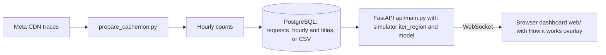
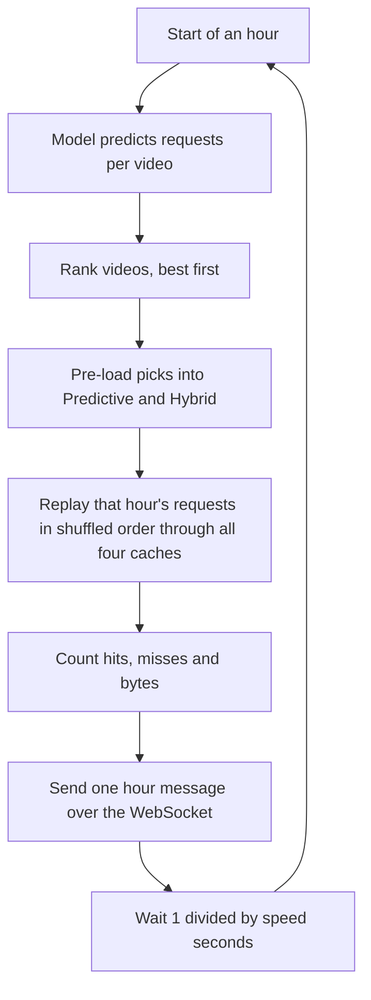

# How Predictive CDN Cache works

This page explains the whole project for people who have never seen it.

## 1. Summary
Websites keep copies of popular files on servers close to their visitors. These servers are called edge caches. A cache has little room, so it must decide what to keep and what to throw out. This project replays real Meta CDN traffic (three edge clusters, 15-22 March 2023) through four simple cache strategies and measures which one answers most requests from its own shelf. Two of the strategies use a machine-learning model that guesses what will be popular in the next hour. The main finding is honest and a little dull: on this traffic, "keep what was used most recently" (LRU) is very hard to beat. The model-based strategies tie it or gain 0.2-0.4 percentage points. The older "keep what is popular overall" strategy (LFU) is far behind.

**How to read this page**
- Non-technical: sections 1-5 and 7.
- Recruiter or professor: this summary, then sections 7, 8 and 11.
- Engineer: everything.

## Contents

1. [Summary](#1-summary)
2. [The problem in plain words](#2-the-problem-in-plain-words)
3. [The data](#3-the-data)
4. [The four cache policies](#4-the-four-cache-policies)
5. [The prediction model](#5-the-prediction-model)
6. [How results are measured](#6-how-results-are-measured)
7. [Results and the honest finding](#7-results-and-the-honest-finding)
8. [System architecture](#8-system-architecture)
9. [Infrastructure](#9-infrastructure)
10. [How to run it](#10-how-to-run-it)
11. [Limitations](#11-limitations)
12. [Roadmap and glossary](#12-roadmap-and-glossary)
13. [Credits](#13-credits)

## 2. The problem in plain words

Think of a small shop shelf that holds only a few items. The warehouse (the **origin**) is far away. If a customer wants something that is on the shelf, it is handed over at once: a **hit**. If not, someone must fetch it from the warehouse: a **miss**. A shop wants as many hits as possible.

A **CDN** (content delivery network) works the same way. Servers near users, called **edge caches**, keep copies of popular files. When the shelf is full and a new item arrives, one item must go. Which one? That rule is the **cache policy**.

This project asks one question: **can a model that predicts what will be popular next hour make a cache better than simple rules?**

To test it, the project builds a simulator. It replays real traffic hour by hour through four policies side by side and keeps score.

## 3. The data

**Source.** Meta CDN traces from the public cacheMon dataset (`cacheMon/cache_dataset`, licence CC BY 4.0), originally released through CacheLib. There are three edge clusters: `eag`, `nha` and `prn`. Each one is a separate region in the project (`CDN-edge-eag`, `CDN-edge-nha`, `CDN-edge-prn`).

**Time span.** 193 hourly buckets (hours 0-192), 15-22 March 2023. Each cluster's hour 0 is its own first timestamp. (The README's "168" is out of date.)

**Sampling.** Two things shrink the data:
1. The published trace files are themselves samples. Their file names carry `0.2000` or `0.8000`. This repo does not document what that number means, so this page does not guess.
2. On top of that, `scripts/prepare_cachemon.py` keeps each cluster's 20,000 most-requested objects, with every request to them.

**Size.** 56,981,489 request rows become 2,925,255 hourly rows. Each hourly row has four columns: `region`, `hour`, `video_id`, `requests`. (The dashboard calls objects "videos"; they are CDN objects of any type.)

**Titles.** A second table, `titles`, holds `region, video_id, title, content_type, size_bytes` for the 20,000 objects per region. The "title" is the anonymised cache key with trailing zeros removed. It is not a real name.

**Where it lives.** In PostgreSQL on Azure, two tables: `requests_hourly` and `titles`. If the environment variable `PGHOST` is not set, the app reads CSV files instead (`data/requests_hourly.csv` by default).

Other sources (Wikipedia pageviews, synthetic traffic) have adapters. They are not used for the results here. New sources plug in through `src/pcache/sources.py`; see [data-sources.md](data-sources.md).

## 4. The four cache policies

All four see the same requests. The cache size is counted in **objects** (for example 200), not in bytes.

Worked example. The shelf has 5 slots and holds A, B, C, D, E. A was used longest ago; E was used most recently. Request counts so far: A has 9, B has 7, C has 6, D has 5, E has 2. Item F, not on the shelf, is requested.

**LRU (Least Recently Used).** Throw out the item untouched for the longest time. F arrives, A leaves. A newcomer is always let in. Every hit moves an item to the "recent" end.

**LFU (Least Frequently Used).** Throw out the item with the fewest requests ever. The least-used item is E (2 requests). F has 1 request so far, which is fewer, so **F is refused**: the shelf stays as it is, and the request still counts as a miss. If F had 3 requests, E would leave and F would come in. Counts are never reset, so LFU keeps items that were popular days ago.

**Predictive.** LRU plus pre-loading. At the start of each test hour the model ranks the videos it expects to be requested. The top picks are loaded before the requests arrive. The budget is 50% of capacity, and only items not already cached count against it. Pre-loaded items age out like anything else. In the example, if the model's top picks were F and E, F would be loaded (a newcomer, so it costs budget and pushes out A) and E would only be refreshed (already cached, so no cost).

**Hybrid.** LRU on 90% of the slots, plus a reserved 10% that holds model picks which the LRU part does not have. The reserved set is replaced every hour. A request served from the reserved part is a hit but is not copied into LRU. A newcomer only pushes out LRU items, never reserved ones. With 200 slots, that is 180 LRU slots and 20 reserved. (With the 5-slot example this would be about 4 and 1.)

## 5. The prediction model

**Plain words.** For every video, the model guesses how many requests it will get in the next hour. It looks at recent history, like a forecaster looking at yesterday's weather.

**Technical.** The count model is scikit-learn's `HistGradientBoostingRegressor(max_iter=200)`. "Gradient boosting" means many small decision trees, each one fixing part of the error that the earlier ones left. The final answer is the sum of all their outputs.

It uses 8 clues per video:

| Clue | Meaning |
| --- | --- |
| lag 1, 2, 3, 6, 24 | requests 1, 2, 3, 6 and 24 hours ago |
| growth | lag 1 minus lag 2 |
| 6-hour average | mean requests over the last 6 hours |
| hour of day | hour number modulo 24 |

**Warm-up and test.**
- Warm-up: hours 0-95 (the first half). The model trains on hours 6-95 (the first 6 hours have no history). The caches fill up. At the end of hour 95 the scores are reset to zero.
- Test: hours 96-192 (97 hours). Only these hours are scored.

**No peeking.** Features for an hour use only earlier hours. The model never trains on test hours. A test (`tests/test_features.py`) checks that changing future hours does not change the features, and another (`tests/test_prefetch_model.py`) checks that the classifier never trains on test hours.

**Replay order.** The data holds counts per hour, not exact request order. Inside each hour the requests are shuffled with a fixed seed, so runs can be repeated. Real arrival order within an hour is therefore not known (see limitations).

**Experimental prefetch classifier.** A second model (`src/pcache/prefetch_model.py`) predicts "will be requested next hour and is not in the LRU cache", weighted by request count. It is opt-in and the dashboard does not use it. It was not adopted because it lost in one region (see section 7).

## 6. How results are measured

| Metric | Meaning | Example |
| --- | --- | --- |
| Hit rate | hits divided by requests | 8 hits out of 10 requests = 80% |
| Byte hit rate | share of requested bytes served from cache | a 90 MB video served from cache out of 100 MB requested = 90% byte hit rate |
| Precision@10 | how many of the model's top 10 are in the real top 10 | 6 of 10 correct = 0.6 |
| MAE (mean absolute error) | average of the absolute gap between predicted and actual requests | errors 2, 1, 0 give (2+1+0)/3 = 1.0 |

Hit rates in reports are measured on the test hours only. Byte hit rate needs object sizes, which the Meta data provides. The experiment reports use it; the live dashboard does not show it.

## 7. Results and the honest finding

Setup: real Meta data, held-out test hours (96-192), cache size 200 objects. Numbers are hit rate in percent, copied from `reports/baseline.csv`.

| Region | LRU | LFU | Predictive | Hybrid | Precision@10 |
| --- | --- | --- | --- | --- | --- |
| eag | 80.97 | 69.13 | 80.98 | 81.18 | 0.3897 |
| nha | 50.53 | 21.42 | 50.55 | 50.93 | 0.3216 |
| prn | 67.42 | 56.54 | 67.43 | 67.80 | 0.4072 |

**What this says.**
- Recency wins. LRU is very hard to beat.
- Predictive is within 0.02 points of LRU. Its picks are mostly already in the LRU cache.
- Hybrid is ahead of LRU by 0.2-0.4 points in every region.
- LFU is far behind. It holds on to items that were popular days ago.
- The model gets about 3 to 4 of its top 10 right (precision@10 0.32-0.41).

**Is the Hybrid gain real or noise?** `reports/noise.csv` repeats the replay with three seeds (0, 1, 2). The Hybrid-minus-LRU gap stayed between 0.20 and 0.47 points in every region and seed. LRU itself moved by less than 0.02 points between seeds.

**Other cache sizes** (`reports/baseline.csv`). At cache 50, Hybrid is ahead of LRU by 0.41 (eag), 0.84 (nha) and 0.67 (prn) points. At cache 1000 the differences shrink to between 0.02 and 0.09 points; at that size every policy except LFU is nearly equal.

**The new classifier** (`reports/before_after.csv`, cache 200, Hybrid with a 20% reserved share):

| Region | LRU hit | New Hybrid hit | Difference | LRU byte hit | New Hybrid byte hit |
| --- | --- | --- | --- | --- | --- |
| eag | 80.966 | 81.607 | +0.641 | 84.849 | 83.515 |
| nha | 50.533 | 50.359 | -0.174 | 74.475 | 71.806 |
| prn | 67.417 | 68.049 | +0.632 | 62.092 | 59.116 |

It won in two of three regions and lost in `nha`. The project's rule is that a change is kept only if Hybrid beats LRU at cache 200 in every region by more than 0.2 points. The classifier fails that rule, so it is not the default. It also costs 1-3 points of byte hit rate.

## 8. System architecture



**Code layout.**
- `src/pcache/`: policies, features, model, prefetch model, simulator, data sources, CSV loaders, database access, reports, command line (`pcache`).
- `api/`: the FastAPI server. Endpoints: `/api/health`, `/api/regions`, `/api/simulate/start`, `/api/simulate/pause`, `/api/simulate/reset`, and the WebSocket `/ws/live`.
- `web/`: the dashboard (plain HTML, JavaScript and D3). It has a live hit-rate chart, bubbles for trending videos, and predicted versus actual counts. A 10-step animated "How it works" overlay opens from the header.
- `scripts/`: data preparation and experiments.
- 85 tests pass.

### One simulated hour



In words: predict, rank, pre-load, replay the real requests, count, tell the browser, wait, repeat. In warm-up hours (0-95) the hour is still replayed to fill the caches, but nothing is scored or sent to the browser. The browser dashboard draws each "hour" message as it arrives.

## 9. Infrastructure

**Docker.** Multi-stage build on `python:3.11-slim`. The builder stage installs the package; the final image holds only `api/`, `web/` and the installed packages. It runs as a non-root user `app`, listens on port 8000 with uvicorn, and bakes in no data and no secrets. The image is stateless: data comes from PostgreSQL or from a mounted `./data`. The image is about 761 MB.

**Docker Compose.** `docker-compose.yml` has one service, `app`. It reads `.env`, publishes port 8000 and mounts `./data` read-only. The mount is not needed in database mode.

**Azure.** Azure Database for PostgreSQL flexible server, Burstable B1ms, 32 GB. The firewall allows only the owner's IP. A budget alert is set, and the plan is to stop the server when it is not in use. Secrets live only in a git-ignored `.env`.

**Planned (not built yet):**
- **(planned)** Terraform, with `make up` and `make down`.
- **(planned)** CI/CD with GitHub Actions: tests and plan on push, manual apply.
- **(planned)** Azure VM running the container.
- **(planned)** Docker Hub image.

## 10. How to run it

Locally (needs data prepared or a database):

```bash
.venv/bin/uvicorn api.main:app --port 8000
```

With Docker Compose:

```bash
cp .env.example .env
docker compose up --build
```

Open http://localhost:8000. Leave the `PG*` lines in `.env` empty to use the CSV files. The database settings are the environment variables `PGHOST`, `PGPORT`, `PGDATABASE`, `PGUSER`, `PGPASSWORD` and `PGSSLMODE`. Other settings are `PCACHE_CSV` and `PCACHE_TITLES`.

More detail: [DASHBOARD_GUIDE.md](DASHBOARD_GUIDE.md) and [data-sources.md](data-sources.md).

## 11. Limitations

- The traffic is sampled twice (see section 3), and only the top 20,000 objects per cluster are kept.
- The simulated cache is small and counted in objects, not bytes. Byte hit rate is reported but not budgeted.
- Traffic is historical and replayed, not live. Counts are shuffled within each hour, so true request order is not used.
- IDs are anonymised. "Titles" are cache keys, not real names.
- Only 8 days of data, so weekly patterns cannot be learned.
- The three clusters share no objects, so there is no cross-region signal.
- The prefetch classifier's settings were chosen on a 3-day sample of one cluster (CDN-edge-eag, hours 0-71); only the winner was confirmed on full data.
- The meaning of `0.2000` / `0.8000` in the trace file names is not documented in this repo.

## 12. Roadmap and glossary

### Roadmap

1. Done: simulator, ML model, real Meta data, custom dashboard, Docker image, Azure PostgreSQL with data.
2. Done, not adopted: stronger prediction (the prefetch classifier; LightGBM did not win), data-source adapters, byte hit rate, versioned model saving.
3. Next: everything local with Docker Compose, then push the image to Docker Hub.
4. Then: Azure by hand (VM and Docker), then Terraform (`make up` / `make down`), then CI/CD with GitHub Actions (tests and plan on push, manual apply button).
5. Later: an exploratory-analysis notebook and a filter script; GitHub README and CV line.

### Glossary

- **CDN**: content delivery network; servers spread around the world that serve popular files close to users.
- **Cache**: a small, fast store of copies.
- **Origin**: the far-away source server that holds everything.
- **Hit / miss**: the file was / was not in the cache.
- **Hit rate**: hits divided by requests.
- **Byte hit rate**: share of requested bytes that came from the cache.
- **Eviction**: removing an item to make room.
- **LRU / LFU**: evict the least recently / least frequently used item.
- **Feature**: one input clue given to a model.
- **Gradient boosting**: many small trees, each fixing part of the remaining error; the answer is their sum.
- **Warm-up / test hours**: first half (fill caches, train, not scored) and second half (scored).
- **Data leakage**: a model seeing information it would not have in real life, such as future hours.
- **Precision@10**: share of the model's top 10 that are in the real top 10.
- **MAE**: mean absolute error, the average size of the prediction miss.
- **PostgreSQL**: a database.
- **Docker**: packages an app and its dependencies into a portable image.
- **FastAPI**: a Python web framework.
- **WebSocket**: a connection that lets the server push messages to the browser.

## 13. Credits

- Traces: cacheMon `cache_dataset` (CC BY 4.0), Meta CDN traces released through CacheLib. The project keeps selected columns, picks the 20,000 most-requested objects per cluster, re-numbers object IDs and aggregates requests into hourly counts. See the README for the full change list.
- Wikipedia hourly pageviews (CC0) have an adapter and remain in `data/` as secondary data. They are not used for the results.
